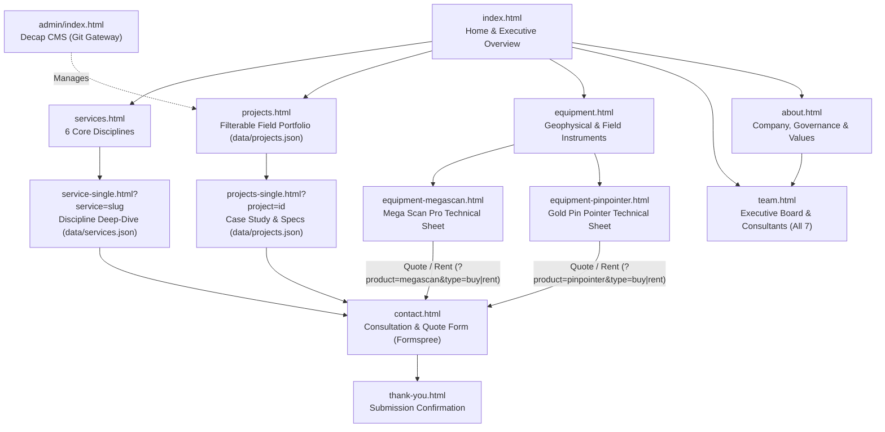

# Briva Exploration & Mining — Website Design & Architecture Refactor Plan

> **Document Purpose:** Self-contained architectural blueprint and implementation specification for an autonomous engineering agent to refactor the Briva Exploration & Mining website from a fragmented, dated template into a cohesive, modern, world-class corporate mining & geological consultancy website.
>
> **Target Repository:** `c:\Users\LUMATO TECH\Pictures\Briva-main`
> **Deployment Target:** Static hosting on **Netlify** with **Decap CMS** (`/admin/`) and **Formspree** (`https://formspree.io/f/xdkvjwqd`).

---

## 1. Executive Summary & Refactor Mandate

Briva Exploration & Mining is a Dar es Salaam–based multidisciplinary mining and mineral exploration consultancy offering geological exploration, resource estimation, mine planning, drilling supervision, artisanal/small-scale mining (ASM) support, M&A/JV advisory, and geophysical detection equipment.

Today, the website suffers from severe visual fragmentation, leftover construction-template boilerplate, broken mobile navigation on product pages, mismatched logos/favicons, and inconsistent page codebases.

### Non-Negotiable Outcomes
1. **World-Class Mining Aesthetic (Clean, Modern, Restrained):**
   - Modelled on Tier-1 international mining & geological consultancies (SRK Consulting, Rio Tinto, Anglo American, Weir Minerals).
   - **Not flashy** (no neon gradients, glowing dark-mode crypto cards, pulsing backgrounds, pill buttons, or auto-sliding animations that hurt readability).
   - **Not dated** (retire the 2017 *Constra* construction template, three-tier bulky header, construction yellow `#ffb600`, all-caps shouting headings, and jQuery/Bootstrap 4 bloat).
2. **100% Unified Design System Across Every Page:**
   - `equipment.html`, `equipment-megascan.html`, and `equipment-pinpointer.html` must share the exact same typography, color tokens, light architectural surfaces, header, mobile navigation, and footer as `index.html`, `services.html`, `projects.html`, `team.html`, `about.html`, and `contact.html`.
3. **Authentic Briva Logo in Browser Tabs (Favicon Suite):**
   - Replace the unrelated, blurry 1.1 KB blue/gold triangle `images/favicon.png` with a crisp multi-size favicon suite (`favicon.ico`, `favicon-32x32.png`, `favicon-16x16.png`, `apple-touch-icon.png`, `site.webmanifest`) extracted directly from the authentic Briva emblem in `images/brivaLogo.png`.
4. **Footer Credit Attribution to Lumato Tech:**
   - Every single page must display **`Designed & Developed by Lumato Tech`** in the footer copyright bar—replacing all instances of `Briva` and `Themefisher`.
5. **Zero Functional Regressions:**
   - Preserve all verified company contact data (`+255 767 413 950`, `info@briva.co.tz`, `11259 Dar Es Salaam - TZ`, Instagram `@briva_mining_exploration`), real projects in `data/projects.json`, real team bios, Decap CMS (`/admin/`) compatibility, Netlify Identity login redirect on `index.html`, and Formspree endpoint (`https://formspree.io/f/xdkvjwqd`).

---

## 2. Diagnostic Audit of the Current Codebase

### 2.1 Three Clashing Visual Dialects
| Page Group | Files | Current Visual Dialect | Core Problems |
| :--- | :--- | :--- | :--- |
| **Dialect A: Legacy Construction Template** | `index.html`, `about.html`, `services.html`, `service-single.html`, `projects.html`, `projects-single.html`, `contact.html`, `404.html`, `thank-you.html` | 2017 *Constra* Bootstrap 4 theme (`css/style.css`, 66 KB) | Heavy uppercase `Montserrat` headings, `Open Sans` 15px body, `#ffb600` construction yellow clashing with `#e97451` terracotta (`74` rules in `style.css`), 3-tier header consuming ~240px vertical height, dead search bar (`#search`). |
| **Dialect B: Dark Neon Gadget Store** | `equipment.html`, `equipment-megascan.html`, `equipment-pinpointer.html` | Custom inline `<style>` blocks (350–700 lines per HTML file!) | Pure black `#0a0a0a`/`#1a1a1a` backgrounds, `#ffb600 -> #ff9500` neon gold gradients, `Outfit` font, `24px` glowing cards, `50px` pill buttons, pulsing radial gradients. Product detail pages **omit the top-bar, mobile hamburger button (breaking mobile navigation completely), and full footer**. |
| **Dialect C: Hybrid Inline Patch** | `team.html` | *Constra* shell + 240-line inline `<style>` (`.team-modern-area`) | Different card radii, shadows, and badges from both Dialect A and Dialect B; omits 7th team member (`Raju Badugu`, Head of Geology) whose headshot exists in `images/team/RAJU BADUGU.jpg`. |

### 2.2 Brand, Logo & Favicon Defects
- **Wrong Browser Tab Icon:** All pages link `<link rel="icon" type="image/png" href="images/favicon.png">`, which is a `1,199`-byte low-resolution blue-and-gold triangle unrelated to Briva's actual logo (`images/brivaLogo.png`).
- **Conflicting Logo Files in `/images/`:**
  - `images/brivaLogo.png` (`500x500`, RGBA): **The authentic brand logo**—mineral copper (`#E07A54`) wordmark *"Briva"* + gear, paired with charcoal (`#2F2D2E`) *"Exploration & Mining"* + diamond-framed mountain & pickaxe mark. However, it has massive transparent padding (`bbox: 59,152 -> 441,348`, actual content `382x196`), forcing `` in the header to waste vertical space.
  - `images/logo.png` and `images/footer-logo.png`: Unused AI-generated alternate logos with completely different emblems and colors. Must be archived/removed.
  - **Dark Footer Contrast Issue:** Placing `images/brivaLogo.png` directly on a dark footer makes the `#2F2D2E` mountain frame and *"Exploration & Mining"* tagline nearly invisible. A reversed light variant (`briva-logo-light.png`) is required.

### 2.3 Content Rot, Broken Links & Structural Bugs
| File(s) | Defect Found During Audit |
| :--- | :--- |
| `404.html`, `thank-you.html` | `<title>` is still `Constra - Construction Html5 Template`; footer credit says `Designed & Developed by Themefisher`; `404.html` banner heading says `Features`. |
| `index.html`, `about.html`, `services.html`, `projects.html`, `team.html`, `contact.html` | `<meta name="description" content="Construction Html5 Template">` left unchanged from template. |
| `All pages` | Footer credit says `Briva` (`index.html`, `about.html`, etc.), `Themefisher` (`404.html`, `thank-you.html`), or is missing altogether (`equipment-megascan.html`, `equipment-pinpointer.html`) instead of **Lumato Tech**. |
| `service-single.html` | Contains raw Lorem Ipsum and hipster-ipsum (`"3 wolf moon officia aute, non cupidatat skateboard dolor brunch. Food truck quinoa..."`), fake testimonial (`"Weldon Cash, CEO, First Choice Group"`), construction hard-hat FAQs, garbled encoding (`industry?Ts`), and broken image paths (`images/projects/project1.jpg`, `project2.jpg` do not exist). |
| `index.html`, `services.html`, `about.html` | Service card titles link to `href="#"`. In `about.html` and `services.html`, footer service links point back to `index.html` instead of specific services. |
| `index.html` | Slide 3 uses an inline `clip-path: polygon(...)` split-image hack; newsletter form posts to `action="#"` (dead); testimonial avatars repeat `images/brivaLogo.png` 3 times; client grid mixes `href="#!"` placeholders with a single captioned `stamicoLogo.png` that breaks row alignment. |
| `about.html` | Empty `<section id="facts" class="facts-area dark-bg">` renders a blank dark band; `images/slider-pages/slide-page1..3.jpg` are pixelated 7–9 KB thumbnails. |
| `projects.html` vs `data/projects.json` | `projects.html` hardcodes 14 static HTML cards while `index.html` and `projects-single.html` fetch `data/projects.json`. Edits made in Decap CMS (`/admin/`) **never appear on `projects.html`**, and `projects.html` has a redundant `"View All Projects"` button linking to itself. |
| `equipment-megascan.html` | `images/megascanPro.jpg` is a `225x225` (11 KB) low-res reseller image containing third-party `"GOLD MASTER"` Arabic/English watermarks, duplicated 4 times as fake `"Angle 1–4"` gallery thumbnails. Meanwhile `downloads/Mega Scan Pro EN.pdf` is **94.7 MB** (near GitHub's 100 MB hard limit). |
| `All inner pages` | `images/banner/banner1.jpg` (`826 KB`) is a stock photo of corporate suits inside a glass room reading `"INNOVATION HUB"`—mismatched for a mineral exploration & mining firm. |
| `Workspace root` | Cluttered with one-off patch scripts and backups: `improvement_1..9_*.py`, `remove_duplicates.py`, `update_video_css.py`, `cleanup_images.ps1`, `convert_slider.ps1`, `create_team_banner.ps1`, `optimize_images.ps1`, `equipment-fixed.html`, `equipment.html.backup`, `test-projects.html`, `contact.php` (unused on Netlify). |

---

## 3. Target Architecture & Directory Structure

### 3.1 Architectural Principles
- **Zero-Build Static Standards:** Pure semantic HTML5, modular native CSS (Custom Properties, CSS Grid, Flexbox, `clamp()`), and clean vanilla ES6 JavaScript (`defer`). No Webpack/Vite build step required—ensuring frictionless Netlify deployment and Decap CMS compatibility.
- **Retire Legacy Plugin Stack:** Remove `jQuery`, `Bootstrap 4`, `Slick Carousel`, `Colorbox`, `Shuffle.js`, and `Animate.css` from all pages (saving ~410 KB of blocking CSS/JS). Replace with native `<dialog>` (lightbox), native `<details>/<summary>` (FAQs), CSS Grid + vanilla filter (`projects.js`), and `IntersectionObserver` scroll reveal.
- **Zero Inline `<style>` Blocks:** All styling lives in 4 clean, cached stylesheets (`tokens.css`, `base.css`, `components.css`, `pages.css`). Inline `style` attributes are prohibited except for setting a scoped CSS custom property when strictly needed (e.g., `style="--hero-bg: url('...')"`).
- **Single Source of Truth for Dynamic Content:**
  - `data/projects.json` drives `index.html` (featured 3), `projects.html` (full filterable catalog), and `projects-single.html` (project detail + related projects).
  - `data/services.json` drives `service-single.html?service=<slug>` so every one of Briva's 6 core disciplines has a complete, technical, Lorem-Ipsum-free detail view linked from `index.html`, `services.html`, and the global footer.
- **Deterministic Shell Parity:** Shared `<head>` links, `<header>`, and `<footer>` blocks are wrapped in explicit `<!-- PARTIAL:HEADER:START -->` / `<!-- PARTIAL:FOOTER:START -->` markers and synchronized/verified via a lightweight Python script (`tools/sync_shell.py` & `tools/verify_site.py`) so headers, favicons, and the **Lumato Tech** credit never drift across pages.

### 3.2 Information Architecture & User Flows



### 3.3 Target Directory Tree
```text
Briva-main/
├── index.html
├── about.html
├── services.html
├── service-single.html
├── projects.html
├── projects-single.html
├── equipment.html
├── equipment-megascan.html
├── equipment-pinpointer.html
├── team.html
├── contact.html
├── thank-you.html
├── 404.html
├── favicon.ico                      # Generated multi-size (16/32/48) Briva emblem
├── site.webmanifest                 # Web app manifest with Briva icons & theme color
├── robots.txt                       # SEO crawler rules + sitemap pointer
├── sitemap.xml                      # Canonical URLs for all public pages
├── .htaccess                        # Preserved caching/security headers
├── _headers                         # Netlify cache & security headers equivalent
├── admin/
│   ├── index.html                   # Decap CMS entry (updated favicon)
│   └── config.yml                   # Decap CMS schema (compatible with projects.json)
├── css/
│   ├── tokens.css                   # Design tokens: colors, fonts, spacing, radii, shadows
│   ├── base.css                     # Reset, typography, a11y focus, container & grid utilities
│   ├── components.css               # Header, footer, buttons, cards, tables, forms, dialog
│   └── pages.css                    # Page-specific section layouts (Home, Equipment, etc.)
├── js/
│   ├── main.js                      # Nav drawer, sticky header, reveal, tabs, lightbox, form
│   ├── projects.js                  # Renders & filters data/projects.json across 3 pages
│   └── services.js                  # Renders data/services.json on service-single.html
├── data/
│   ├── projects.json                # 14 real Tanzanian projects (enriched & normalized)
│   ├── services.json                # Complete technical copy for all 6 Briva disciplines
│   └── site-settings.json           # CMS general settings
├── images/
│   ├── brivaLogo.png                # Original master logo (preserved)
│   ├── favicon.png                  # Overwritten with crisp 32x32 Briva mark for legacy paths
│   ├── brand/                       # Generated clean brand suite
│   │   ├── briva-logo.png           # Trimmed 382x196 full-color logo (light surfaces)
│   │   ├── briva-logo-light.png     # Reversed 382x196 white+copper logo (dark footer)
│   │   ├── favicon-16x16.png
│   │   ├── favicon-32x32.png
│   │   ├── apple-touch-icon.png     # 180x180 iOS icon
│   │   ├── icon-192.png
│   │   ├── icon-512.png
│   │   └── og-image.jpg             # 1200x630 Open Graph social preview card
│   ├── hero/                        # Optimized WebP/JPEG field & geological hero banners
│   ├── projects/                    # Optimized WebP/JPEG project photos (.tiff converted)
│   ├── equipment/                   # Clean studio product images
│   ├── team/                        # 7 team portraits
│   └── clients/                     # Client partner logos
├── downloads/
│   └── Mega Scan Pro EN.pdf         # Existing manual (see Section 7.3 note)
└── tools/
    ├── make_brand_assets.py         # Generates images/brand/*, favicon.ico, site.webmanifest
    ├── optimize_assets.py           # Converts .tiff & oversized >500KB JPGs to crisp WebP/JPG
    ├── sync_shell.py                # Syncs canonical header/footer partials across all pages
    └── verify_site.py               # Automated QA & parity checker
```

> [!CAUTION]
> **No Git Repository Initialized:** `c:\Users\LUMATO TECH\Pictures\Briva-main` does **not** currently have a `.git` folder. Before deleting or overwriting any existing file, **Phase 0** requires creating a timestamped backup archive (`_backup_pre_refactor.zip` outside the deploy tree or `git init && git add -A && git commit -m "chore: baseline before refactor"`). Initializing Git locally is strongly preferred so every refactor phase is cleanly revertible and ready for Netlify Git Gateway.

---

## 4. Visual Identity, Brand Pipeline & Design Tokens

### 4.1 Aesthetic Direction: *"East African Mineral Authority"*
- **Surface Balance:** **80% crisp light mineral-paper surfaces** (`#FFFFFF` and `#F5F7F9`), **15% deep basalt-slate structural anchors** (`#0F1A24` and `#162432` for top utility bar, hero overlays, key capability band, and footer), and **5% Briva mineral copper** (`#D96B43` / `#E07A54`) derived directly from `images/brivaLogo.png`—used strictly for primary CTAs, active indicators, and key structural accents.
- **Architectural Geometry:** Hairline `1px solid #DFE5EC` borders, restrained `4px` button/input corners and `8px` card corners, generous whitespace (`88px–112px` desktop section padding), and structured multi-column grids inspired by geological cross-sections and technical reports.

### 4.2 Color Tokens (`css/tokens.css`)
All foreground/background pairs meet **WCAG 2.1 AA** (`>= 4.5:1` normal text, `>= 3:1` UI components and large headings). Note that raw `#E07A54` on white has a `2.95:1` ratio, so `--brand-600: #C85A32` (`4.56:1` on `#FFFFFF`) is used whenever copper appears as text on light backgrounds or filled buttons with white text, while `--brand-400: #E07A54` is used as a graphic accent and on dark `#0F1A24` surfaces (`6.1:1` contrast).

```css
:root {
  /* Surfaces (Light Mineral Paper & Stone) */
  --bg-canvas:        #FFFFFF;
  --bg-subtle:        #F5F7F9;   /* Alternating section background */
  --bg-muted:         #EBEEF2;   /* Table headers, neutral badges, product studio well */
  --bg-elevated:      #FFFFFF;

  /* Basalt Slate (Dark Structural Anchors: Topbar, Hero Overlay, Stats, Footer) */
  --ink-950:          #0A1219;   /* Footer bottom copyright bar */
  --ink-900:          #0F1A24;   /* Primary dark band & footer surface */
  --ink-800:          #182736;   /* Dark surface cards / hover */
  --ink-700:          #263849;   /* Dark surface hairline borders */

  /* Text Hierarchy */
  --text-primary:     #111921;   /* Headings & strong values (17.4:1 on white) */
  --text-body:        #334150;   /* Body copy (10.3:1 on white) */
  --text-muted:       #5B6B7C;   /* Metadata, captions, labels (5.4:1 on white) */
  --text-on-dark:     #F8FAFC;   /* Primary text on --ink-900 */
  --text-on-dark-muted:#B0BECB;  /* Secondary text on --ink-900 (7.8:1) */

  /* Briva Mineral Copper (Derived from brivaLogo.png #E07A54) */
  --brand-400:        #E07A54;   /* Logo native copper — use on dark surfaces & 2px accent rules */
  --brand-500:        #D4653B;   /* Hover accent on dark surfaces */
  --brand-600:        #C85A32;   /* Primary CTA fill & copper text on white (4.56:1 AA with #FFF) */
  --brand-700:        #A84825;   /* Primary CTA hover/active fill */
  --brand-tint:       #FDF3EF;   /* Subtle icon container & active filter pill background */
  --brand-tint-border:#F3CFC0;   /* Subtle copper border */

  /* Borders & Dividers */
  --border-subtle:    #E4E9EF;
  --border-strong:    #CBD4DF;

  /* Semantic Feedback */
  --status-success:   #166534;
  --status-success-bg:#F0FDF4;
  --status-error:     #B91C1C;
  --status-error-bg:  #FEF2F2;

  /* Typography */
  --font-heading:     'Archivo', -apple-system, BlinkMacSystemFont, 'Segoe UI', sans-serif;
  --font-body:        'Inter', -apple-system, BlinkMacSystemFont, 'Segoe UI', sans-serif;

  /* Fluid Type Scale */
  --text-xs:          0.75rem;                                  /* 12px — Eyebrows, badges */
  --text-sm:          0.875rem;                                 /* 14px — Nav, metadata, tables */
  --text-base:        1rem;                                     /* 16px — Standard body */
  --text-lg:          1.125rem;                                 /* 18px — Lead paragraphs */
  --text-xl:          1.25rem;                                  /* 20px — Card titles */
  --text-2xl:         clamp(1.375rem, 1.2rem + 0.7vw, 1.75rem); /* 22–28px — H3 */
  --text-3xl:         clamp(1.75rem, 1.4rem + 1.4vw, 2.375rem); /* 28–38px — Section H2 */
  --text-4xl:         clamp(2.125rem, 1.6rem + 2.2vw, 3.25rem); /* 34–52px — Page & Home H1 */

  /* Spacing & Layout */
  --space-1: 0.25rem;  --space-2: 0.5rem;   --space-3: 0.75rem;  --space-4: 1rem;
  --space-5: 1.25rem;  --space-6: 1.5rem;   --space-8: 2rem;     --space-10: 2.5rem;
  --space-12: 3rem;    --space-16: 4rem;    --space-20: 5rem;    --space-24: 6rem;

  --container-max:    1240px;
  --container-pad:    clamp(1.25rem, 4vw, 2.5rem);
  --section-py:       clamp(4rem, 7vw, 6.5rem);

  /* Radii & Elevation (Clean Engineering Restraint) */
  --radius-sm:        4px;       /* Buttons, inputs, tags */
  --radius-md:        8px;       /* Cards, image frames, spec tables */
  --radius-lg:        12px;      /* Modal dialog, large feature callout */
  --shadow-xs:        0 1px 2px rgba(15, 26, 36, 0.05);
  --shadow-sm:        0 4px 12px rgba(15, 26, 36, 0.06);
  --shadow-md:        0 12px 28px rgba(15, 26, 36, 0.10);
  --ease-out:         cubic-bezier(0.22, 1, 0.36, 1);
}
```

### 4.3 Typography Rules (`css/base.css`)
- **Google Fonts Load (Single Request across all pages, replacing `Montserrat`, `Open Sans`, `Roboto Slab`, and `Outfit`):**
  ```html
  <link rel="preconnect" href="https://fonts.googleapis.com">
  <link rel="preconnect" href="https://fonts.gstatic.com" crossorigin>
  <link href="https://fonts.googleapis.com/css2?family=Archivo:wght@500;600;700&family=Inter:wght@400;500;600&display=swap" rel="stylesheet">
  ```
- **Sentence/Title Case Headings:** Never apply `text-transform: uppercase` to `h1`–`h6`. Headings use `font-family: var(--font-heading)`, `font-weight: 600` (or `700` for `h1`), `letter-spacing: -0.02em`, `line-height: 1.18`.
- **Eyebrow Labels (`.eyebrow`):** The *only* uppercase text element—`12px` (`var(--text-xs)`), `font-weight: 600`, `letter-spacing: 0.12em`, `text-transform: uppercase`, `color: var(--brand-600)` (or `var(--brand-400)` on dark bands), preceded by a `20px × 2px` horizontal copper rule.
- **Technical Numerals:** Apply `font-variant-numeric: tabular-nums` to `.stat-value`, `.spec-table`, `.price-amount`, phone numbers, working hours, and project area (`sq km`) metrics.

### 4.4 Brand Asset & Browser-Tab Favicon Generation (`tools/make_brand_assets.py`)
Create and run `tools/make_brand_assets.py` (Python 3 + Pillow `PIL`, verified installed in workspace) to generate the trimmed header logo, reversed dark-footer logo, Open Graph card, and complete browser-tab favicon suite directly from `images/brivaLogo.png`:

```python
"""Generate Briva brand assets and browser-tab favicons from images/brivaLogo.png.
Run from project root:  python tools/make_brand_assets.py
"""
import json
import os
import shutil
from PIL import Image

ROOT = os.getcwd()
OUT = os.path.join(ROOT, "images", "brand")
os.makedirs(OUT, exist_ok=True)

INK = (15, 26, 36)  # --ink-900 #0F1A24
src = Image.open(os.path.join(ROOT, "images", "brivaLogo.png")).convert("RGBA")


def is_copper(r, g, b):
    return r > 150 and (r - b) > 60


# 1. Trimmed full-color logo for light header (382x196, zero dead padding)
logo = src.crop(src.getbbox())
logo.save(os.path.join(OUT, "briva-logo.png"), optimize=True)

# 2. Reversed logo for dark #0F1A24 footer (charcoal -> crisp white, copper preserved)
light = logo.copy()
px = light.load()
for y in range(light.height):
    for x in range(light.width):
        r, g, b, a = px[x, y]
        if a and not is_copper(r, g, b):
            px[x, y] = (255, 255, 255, a)
light.save(os.path.join(OUT, "briva-logo-light.png"), optimize=True)

# 3. Isolate Briva emblem (copper gear + mountain diamond + pickaxe) for favicons
X0, Y0, X1, Y1 = 283, 148, 446, 268
mark = src.crop((X0, Y0, X1, Y1))
mp = mark.load()
for y in range(mark.height):
    for x in range(mark.width):
        ax, ay = x + X0, y + Y0
        r, g, b, a = mp[x, y]
        if ay >= 232 and not (372 <= ax <= 402):
            mp[x, y] = (0, 0, 0, 0)  # strip top of wordmark letters 'v'/'a'
        elif ay >= 250 and a and is_copper(r, g, b):
            mp[x, y] = (0, 0, 0, 0)  # preserve only dark diamond tip at bottom
mark = mark.crop(mark.getbbox())


def square_icon(img, size, pad_ratio=0.06, bg=(0, 0, 0, 0)):
    side = max(img.width, img.height)
    pad = int(side * pad_ratio)
    canvas = Image.new("RGBA", (side + 2 * pad, side + 2 * pad), bg)
    canvas.paste(img, (pad + (side - img.width) // 2, pad + (side - img.height) // 2), img)
    return canvas.resize((size, size), Image.LANCZOS)


square_icon(mark, 16).save(os.path.join(OUT, "favicon-16x16.png"), optimize=True)
square_icon(mark, 32).save(os.path.join(OUT, "favicon-32x32.png"), optimize=True)
square_icon(mark, 192).save(os.path.join(OUT, "icon-192.png"), optimize=True)
square_icon(mark, 512).save(os.path.join(OUT, "icon-512.png"), optimize=True)
square_icon(mark, 180, pad_ratio=0.14, bg=(255, 255, 255, 255)).convert("RGB").save(
    os.path.join(OUT, "apple-touch-icon.png"), optimize=True
)
square_icon(mark, 256).save(
    os.path.join(ROOT, "favicon.ico"), sizes=[(16, 16), (32, 32), (48, 48)]
)
# Also overwrite legacy images/favicon.png so admin/index.html & cached bookmarks show Briva mark
shutil.copyfile(os.path.join(OUT, "favicon-32x32.png"), os.path.join(ROOT, "images", "favicon.png"))

# 4. Web App Manifest
with open(os.path.join(ROOT, "site.webmanifest"), "w", encoding="utf-8") as f:
    json.dump({
        "name": "Briva Exploration & Mining",
        "short_name": "Briva",
        "icons": [
            {"src": "images/brand/icon-192.png", "sizes": "192x192", "type": "image/png"},
            {"src": "images/brand/icon-512.png", "sizes": "512x512", "type": "image/png"},
        ],
        "theme_color": "#0F1A24",
        "background_color": "#FFFFFF",
        "display": "standalone",
    }, f, indent=2)

# 5. Open Graph Social Preview Card (1200x630)
W, H = 1200, 630
bg_path = os.path.join(ROOT, "images", "slider-main", "bg2.jpg")
photo = Image.open(bg_path).convert("RGB")
scale = max(W / photo.width, H / photo.height)
photo = photo.resize((int(photo.width * scale) + 1, int(photo.height * scale) + 1), Image.LANCZOS)
left, top = (photo.width - W) // 2, (photo.height - H) // 2
og = photo.crop((left, top, left + W, top + H)).convert("RGBA")
og = Image.alpha_composite(og, Image.new("RGBA", (W, H), INK + (210,)))
lw = 440
lg = light.resize((lw, int(light.height * lw / light.width)), Image.LANCZOS)
og.paste(lg, ((W - lg.width) // 2, (H - lg.height) // 2), lg)
og.convert("RGB").save(os.path.join(OUT, "og-image.jpg"), quality=86, optimize=True)
print("Generated Briva brand & favicon suite successfully.")
```

---

## 5. Canonical Global Shell & Component Specifications

### 5.1 Canonical `<head>` Block (Every Page)
Every public HTML page must use this clean `<head>` structure (customizing only `<title>`, `meta[name="description"]`, `link[rel="canonical"]`, and `og:title`/`og:description`):

```html
<head>
  <meta charset="utf-8">
  <meta name="viewport" content="width=device-width, initial-scale=1.0">
  <title>{{PAGE_TITLE}} | Briva Exploration &amp; Mining</title>
  <meta name="description" content="{{PAGE_DESCRIPTION}}">
  <meta name="theme-color" content="#0F1A24">

  <!-- Favicons (Authentic Briva Emblem on Browser Tab) -->
  <link rel="icon" href="favicon.ico" sizes="any">
  <link rel="icon" type="image/png" sizes="32x32" href="images/brand/favicon-32x32.png">
  <link rel="icon" type="image/png" sizes="16x16" href="images/brand/favicon-16x16.png">
  <link rel="apple-touch-icon" sizes="180x180" href="images/brand/apple-touch-icon.png">
  <link rel="manifest" href="site.webmanifest">

  <!-- Open Graph -->
  <meta property="og:type" content="website">
  <meta property="og:site_name" content="Briva Exploration &amp; Mining">
  <meta property="og:title" content="{{PAGE_TITLE}} | Briva Exploration &amp; Mining">
  <meta property="og:description" content="{{PAGE_DESCRIPTION}}">
  <meta property="og:image" content="images/brand/og-image.jpg">

  <!-- Typography -->
  <link rel="preconnect" href="https://fonts.googleapis.com">
  <link rel="preconnect" href="https://fonts.gstatic.com" crossorigin>
  <link href="https://fonts.googleapis.com/css2?family=Archivo:wght@500;600;700&family=Inter:wght@400;500;600&display=swap" rel="stylesheet">

  <!-- Modular Stylesheets (Zero inline <style> blocks) -->
  <link rel="stylesheet" href="css/tokens.css">
  <link rel="stylesheet" href="css/base.css">
  <link rel="stylesheet" href="css/components.css">
  <link rel="stylesheet" href="css/pages.css">
</head>
```
*(Note: Keep the Netlify Identity `<script src="https://identity.netlify.com/v1/netlify-identity-widget.js" defer></script>` and `/admin/` login redirect **only** on `index.html`.)*

### 5.2 Canonical Site Header (`<!-- PARTIAL:HEADER:START -->`)
Replaces the bulky 240px three-tier *Constra* header with a sleek **two-part architectural header** (`36px` slim dark utility strip on desktop + `76px` sticky white navigation bar):

- **Top Utility Bar (`.topbar`, hidden below `992px`—contact details move inside mobile drawer footer):**
  - Background: `var(--ink-900)` (`#0F1A24`), text `13px` `var(--text-on-dark-muted)`.
  - Left: `Dar es Salaam, Tanzania (P.O. Box 11259)` · `Mon–Fri 10:00–16:00 | Sat 12:00–15:00`
  - Right: clickable `<a href="tel:+255767413950">+255 767 413 950</a>` · `<a href="mailto:info@briva.co.tz">info@briva.co.tz</a>` · Instagram link (`https://www.instagram.com/briva_mining_exploration`)
- **Main Sticky Bar (`.site-header`):**
  - Background: `#FFFFFF`, `border-bottom: 1px solid var(--border-subtle)`, `position: sticky; top: 0; z-index: 100`. Adds `box-shadow: var(--shadow-sm)` via `.is-scrolled` when `window.scrollY > 16`.
  - **Left (Brand):** `<a class="site-brand" href="index.html"></a>` (rendered at `height: 46px; width: auto` so proportions are razor-sharp).
  - **Center (Primary Nav `.site-nav`):**
    1. `Home` (`index.html`)
    2. `About` (`about.html`)
    3. `Services` (`services.html` — active also on `service-single.html`)
    4. `Projects` (`projects.html` — active also on `projects-single.html`)
    5. `Equipment` (`equipment.html` — active also on `equipment-megascan.html` & `equipment-pinpointer.html`)
    6. `Team` (`team.html`)
    - Active link styling: `color: var(--text-primary); font-weight: 600` with a `2px` bottom bar in `var(--brand-600)` and `aria-current="page"`.
    - Remove the dead `#search` magnifying glass completely.
  - **Right (Header CTA):** `<a class="btn btn--primary btn--sm" href="contact.html">Contact Us</a>` (marked active when on `contact.html`).
  - **Mobile Drawer (`< 992px`):** Accessible `<button class="nav-toggle" aria-expanded="false" aria-controls="mobile-nav" aria-label="Open navigation menu">` with crisp 24×24 SVG hamburger/close icon, opening a clean full-height slide-over panel containing the 6 nav links, direct phone/email links, and `"Request Consultation"` CTA. **Fixes the broken mobile navigation on `equipment-megascan.html` and `equipment-pinpointer.html`.**

### 5.3 Canonical Site Footer & Lumato Tech Attribution (`<!-- PARTIAL:FOOTER:START -->`)
Every page must share the exact same 4-column basalt-slate footer (`background: var(--ink-900); color: var(--text-on-dark-muted)`):

- **Column 1 — Brand & Mandate (`4fr`):**
  - `` (displayed at `height: 48px; width: auto`).
  - Concise summary: *"Multidisciplinary mineral exploration, geological consulting, mine planning, and geophysical equipment specialists serving East Africa."*
  - Verified social link: Instagram (`https://www.instagram.com/briva_mining_exploration` — remove dead `href="#"` Facebook/Twitter links unless real URLs are added to `site-settings.json`).
- **Column 2 — Core Services (`3fr`):**
  - Deep links directly to each discipline (no `href="index.html"` or `href="#"`):
    - `service-single.html?service=geological-exploration` — Geological & Exploration
    - `service-single.html?service=resource-estimation` — Resource Estimation & Modelling
    - `service-single.html?service=mine-planning` — Mining Engineering & Planning
    - `service-single.html?service=drilling-supervision` — Drilling Supervision
    - `service-single.html?service=asm-support` — Artisanal & Small-Scale Mining
    - `service-single.html?service=ma-advisory` — M&A and Joint Ventures
- **Column 3 — Company & Equipment (`2fr`):**
  - Links to `about.html`, `projects.html`, `equipment.html`, `equipment-megascan.html`, `equipment-pinpointer.html`, `team.html`, `contact.html`.
- **Column 4 — Head Office & Hours (`3fr`):**
  - `11259 Dar es Salaam, Tanzania`
  - `<a href="tel:+255767413950">+255 767 413 950</a>`
  - `<a href="mailto:info@briva.co.tz">info@briva.co.tz</a>`
  - Working hours: `Mon–Fri: 10:00 – 16:00` · `Sat: 12:00 – 15:00`
- **Bottom Copyright & Lumato Tech Bar (`.site-footer__bottom`, `background: var(--ink-950); border-top: 1px solid var(--ink-700)`):**
  ```html
  <div class="site-footer__bottom">
    <div class="container site-footer__bottom-inner">
      <p class="site-footer__copyright">
        &copy; <span data-year>2026</span> Briva Exploration &amp; Mining. All rights reserved.
      </p>
      <p class="site-footer__credit">
        Designed &amp; Developed by <a href="https://lumatotech.netlify.app" target="_blank" rel="noopener noreferrer">Lumato Tech</a>
      </p>
    </div>
  </div>
  ```
  *(Style the `Lumato Tech` anchor with `color: var(--text-on-dark); font-weight: 500; text-decoration: underline; text-underline-offset: 3px; text-decoration-color: var(--brand-400)` so it reads cleanly, professionally, and unmistakably.)*

### 5.4 Core Reusable UI Components (`css/components.css`)
1. **Buttons (`.btn`):**
   - `height: 46px` (`--sm`: `38px`, `--lg`: `52px`), `padding: 0 1.375rem`, `border-radius: var(--radius-sm)` (`4px` — **never `50px` pills**), `font-family: var(--font-body)`, `font-weight: 600`, `font-size: 0.9375rem`.
   - `.btn--primary`: `background: var(--brand-600); color: #FFFFFF` -> hover `var(--brand-700)`.
   - `.btn--outline`: `background: transparent; color: var(--text-primary); border: 1px solid var(--border-strong)` -> hover `border-color: var(--text-primary); background: var(--bg-subtle)`.
   - `.btn--outline-light` (on dark surfaces): `border: 1px solid rgba(248, 250, 252, 0.32); color: #FFFFFF` -> hover `background: rgba(255, 255, 255, 0.08); border-color: #FFFFFF`.
2. **Section Header (`.section-head`):**
   - Left-aligned by default (with `.section-head--split` placing heading left and action button/lead paragraph right on desktop).
   - Contains `<span class="eyebrow">...</span>`, `<h2>...</h2>`, and optional `<p class="section-lead">...</p>` (`max-width: 62ch`).
3. **Inner Page Hero (`.page-hero`):**
   - Replaces the stock indoor `"INNOVATION HUB"` banner across all inner pages.
   - Compact, authoritative height (`padding: clamp(3.5rem, 6vw, 5.25rem) 0`), dark basalt background (`var(--ink-900)`) layered over real field photography (`images/slider-main/bg2.jpg` or section-appropriate field image) with a directional gradient overlay `linear-gradient(90deg, rgba(15,26,36,0.92) 0%, rgba(15,26,36,0.72) 60%, rgba(15,26,36,0.55) 100%)`.
   - Includes semantic breadcrumb (`Home / Current Page`), `<h1>`, and concise 1-sentence subtitle.
4. **Cards (`.card`):**
   - Base: `background: var(--bg-elevated); border: 1px solid var(--border-subtle); border-radius: var(--radius-md)` (`8px`), subtle hover transition (`border-color: var(--border-strong); box-shadow: var(--shadow-sm); transform: translateY(-2px)` — **never `-15px` exaggerated jumps**).
   - **Service Card (`.service-card`):** Numbered index (`01`–`06` in `Archivo` tabular numerals + crisp 24×24 stroke SVG icon), discipline title, concise summary, key deliverables list (`3` bullet points), and `"Explore Service →"` link.
   - **Project Card (`.project-card`):** `16:10` aspect-ratio image frame (`object-fit: cover`), subtle category badge (`Exploration`, `Mining`, `Mapping`), project title, location + area/year metadata strip (`Dodoma · 45 sq km · 2024`). Clicking opens `projects-single.html?project=<id>`.
   - **Equipment Card (`.equipment-card`):** Light architectural card matching `.project-card` & `.service-card`! Neutral studio image well (`background: var(--bg-subtle); aspect-ratio: 4/3; padding: 2rem; border-bottom: 1px solid var(--border-subtle)`), category eyebrow (`Geophysical Scanner` / `Precision Detector`), title, 2-sentence engineering overview, compact 2×2 key-spec strip (`Max Depth: 50 m`, `Scan Range: 3,000 m`, etc.), formatted price (`TZS 20,000,000`), and `"Technical Specifications →"` CTA button.
   - **Team Card (`.team-card`):** Clean `1:1` or `4:5` portrait container (`background: var(--bg-subtle)`). For members whose source file is `147×147` (`Alex S. Bashire`, `K. Sridhar Reddy`), constrain avatar display inside a crisp `112×112` framed portrait medallion or structured executive horizontal card so low-res pixels are **never stretched across a 400px box**!

---

## 6. Page-by-Page Refactor Specifications

### 6.1 `index.html` — Home
Replace the 3-slide Slick carousel (and its diagonal `clip-path` collage) with a **fast-loading, zero-CLS static Executive Hero**:
1. **Executive Hero (`.home-hero`):**
   - Full-bleed field photograph (`images/slider-main/bg2.jpg` — geologists examining drill core trays at an open-pit operation, optimized to WebP + JPG fallback, `fetchpriority="high"`, eager load) with dark slate gradient overlay.
   - Eyebrow: `Mineral Exploration & Mining Consultancy · Tanzania`
   - `<h1>`: `Technical Precision Across the Mining Value Chain`
   - Lead: `Briva partners with investors, mining houses, and cooperatives across East Africa—delivering geological exploration, 3D resource estimation, mine planning, drilling supervision, and certified geophysical equipment.`
   - Primary CTA: `Explore Our Services` (`services.html`) · Secondary CTA: `Request a Consultation` (`contact.html`).
   - **Bottom Attached Capability Bar (`.hero-metrics`):** 4-column structured strip on `var(--ink-900)` separated by `1px solid var(--ink-700)` vertical hairlines:
     - `6 Core Disciplines` — Exploration to M&A Advisory
     - `14+ Field Programmes` — Gold, Lithium, Graphite, Coal & Base Metals
     - `Multi-Commodity` — Precious, Battery & Industrial Minerals
     - `End-to-End Delivery` — Reconnaissance, Drilling & Mine Design
2. **Who We Are & Governance Summary:** 2-column asymmetric split—company overview + core differentiators on the left; clean 3-item Vision, Mission & Core Values summary cards on the right (replacing the clunky Bootstrap collapse accordion), linking to `about.html`.
3. **Core Services Grid (`6` Cards, 3×2 Desktop Grid on `--bg-subtle`):**
   - All 6 services rendered with crisp SVG technical icons and linking to `service-single.html?service=<slug>` (zero `href="#"`!).
4. **Featured Field Projects (`#recent-projects-container`):**
   - Powered by `js/projects.js` reading `data/projects.json`. Highlight 3 flagship diverse projects (`lithium-dodoma`, `cu-zn-mpanda`, `coal-mapping-liweta` via a `"featured": true` flag in `projects.json`, falling back to first 3). Includes `"View All 14 Projects →"` button to `projects.html`.
5. **Exploration & Field Equipment Highlight Band:**
   - Clean 2-column executive callout introducing Briva's geophysical detection systems (**Mega Scan Pro** & **Gold Pin Pointer** — available for purchase or field rental) with direct link to `equipment.html`—bridging Consulting and Equipment cohesively.
6. **Client Partners & Testimonials:**
   - **Partners Row:** Normalized logo boxes (`height: 72px`, `padding: 12px 20px`, `background: var(--bg-subtle)`, subtle grayscale-to-color hover) for `client1.png`–`client6.png` and `stamicoLogo.png` (`https://www.stamico.co.tz/`) with uniform alignment (remove the stray `<figcaption>` that broke the grid).
   - **Testimonials Grid:** 3 static cards side-by-side on desktop (retiring Slick carousel!) featuring the 3 real quotes (`Edward M. — Mine Manager`, `Joel M. — CFO, AIL`, `Pendo M. — HR, Jitegemee`) with clean typographic monogram badges (`EM`, `JM`, `PM`) instead of repeating `brivaLogo.png` three times.
7. **Executive Consultation CTA Band:**
   - Replaces the broken `<form action="#">` newsletter bar with a clean basalt-slate callout: *"Planning an exploration programme or resource evaluation in Tanzania?"* + `+255 767 413 950` + `"Schedule a Consultation"` (`contact.html`).

### 6.2 `about.html` — About Us
- **Page Hero:** Breadcrumb `Home / About Us`, title `Multidisciplinary Mining & Geological Expertise`.
- **Company Profile & Tanzanian Footprint:** Clean 2-column editorial layout pairing the company narrative with `images/projects/Core drilling.jpg` + `images/projects/Coal outcro mapping_Liweta.jpg` (retiring the pixelated 7 KB `slide-page1..3.jpg` slider).
- **Remove Empty `#facts` Slab:** Delete the empty `<section id="facts">` block completely; replace with a 4-pillar **Commodities & Geological Settings** strip (`Precious Metals: Gold`, `Battery & Critical Minerals: Lithium, Graphite, Beryllium`, `Energy Minerals: Coal`, `Base & Industrial Minerals: Cu-Zn, Dolomite, Quartz`).
- **Vision, Mission & 6 Core Values:** Clean architectural grid (`Integrity`, `Excellence`, `Innovation`, `Sustainability`, `Collaboration`, `Safety`)—visible at a glance without hidden accordions.
- **Leadership Preview:** Concise executive preview linking to `team.html` (rather than duplicating a full Slick carousel).

### 6.3 `services.html` & `service-single.html` — Services & Discipline Detail
- **Purge All Template Boilerplate:** Completely remove every trace of Lorem Ipsum, `"3 wolf moon"`, `"Weldon Cash"`, construction hard-hat FAQs, and broken `project1.jpg`/`project2.jpg` references from `service-single.html`.
- **`services.html`:**
  - Page Hero + 6 comprehensive Service Cards in a 2-column or 3-column architectural layout, followed by a **5-Stage Engagement Workflow** (`01 Reconnaissance & Desktop Study` → `02 Field Mapping & Sampling` → `03 Drilling & Subsurface Analysis` → `04 Resource Estimation & Mine Design` → `05 Compliance, JVs & Execution`) and a Consultation CTA.
- **`service-single.html` + `data/services.json` + `js/services.js`:**
  - Create `data/services.json` containing rich, domain-accurate geological & mining copy for all 6 Briva disciplines:
    1. `geological-exploration` — Geological & Exploration Services
    2. `resource-estimation` — Resource Estimation & 3D Geological Modelling
    3. `mine-planning` — Mining Engineering, Mine Planning & Technical Reporting
    4. `drilling-supervision` — Drilling Supervision & Exploration Project Management
    5. `asm-support` — Support for Small-Scale & Artisanal Mining (ASM)
    6. `ma-advisory` — Mergers, Acquisitions, Joint Ventures & Financial Analysis
  - Each entry in `data/services.json` includes: `slug`, `title`, `subtitle`, `overview` (2–3 paragraphs), `deliverables` (5–6 concrete outputs), `methodology` (3 steps), `faqs` (3 real mining/exploration FAQs rendered with native `<details>/<summary>`), `image` (mapped to an existing high-res photo in `images/projects/` or `images/resouceEst1.jpeg`), and `relatedProjects` (IDs from `data/projects.json`).
  - `service-single.html` renders a sticky left sidebar navigation listing all 6 disciplines (highlighting the active `?service=<slug>`, defaulting to `geological-exploration` if no query param is present) + a direct `"Enquire About This Service"` sidebar card linking to `contact.html?service=<slug>`.

### 6.4 `projects.html` & `projects-single.html` — Field Portfolio
- **Fix Decap CMS Disconnect:** Remove the 14 hardcoded HTML cards from `projects.html` and render the entire grid dynamically from `data/projects.json` via `js/projects.js` (keeping a `<noscript>` graceful message). Now any project added in `/admin/` automatically updates `index.html`, `projects.html`, and `projects-single.html`.
- **Filter Bar:** Accessible button pills (`All Projects (14)`, `Exploration`, `Mining`, `Mapping`) matching the existing categories in `data/projects.json` via case-insensitive substring/array matching, updating URL query `?category=exploration` without page reload.
- **Remove Self-Referential Button:** Remove the redundant `"View All Projects"` button at the bottom of `projects.html`; replace with a `"Have a licence area or deposit to evaluate? Discuss Your Project →"` CTA band.
- **`projects-single.html`:**
  - Clean 2-column technical case study layout:
    - Left (`7 cols`): Primary field photograph (with click-to-zoom native `<dialog>` lightbox) + narrative overview + scope of work tags.
    - Right (`5 cols`): Structured **Project Specification Sheet** (`Client`, `Location`, `Area / Scope`, `Year`, `Discipline`) + `"Request Similar Survey"` CTA (`contact.html?service=geological-exploration`) + `"← Back to All Projects"`.
  - Bottom section: `3` **Related Field Projects** from the same category/region.

### 6.5 `equipment.html`, `equipment-megascan.html`, `equipment-pinpointer.html` — Equipment (Unification Priority)
> [!IMPORTANT]
> This is the single biggest visual mismatch flagged by the user. All three equipment files must drop their `350–700` line `<style>` blocks, `Outfit` font, `#0a0a0a` black backgrounds, neon gold gradients, and `24px`/`50px` rounded pills, and adopt the exact global stylesheets (`tokens.css`, `base.css`, `components.css`, `pages.css`), header, mobile drawer, and Lumato Tech footer.

- **`equipment.html` (Catalog):**
  - Standard `.page-hero` (`Field & Geophysical Detection Equipment`).
  - **2-Column Product Showcase** on clean light surface (`#FFFFFF` cards on `--bg-subtle` section):
    - **Mega Scan Pro** (`TZS 20,000,000` · Purchase or Rental) — 6 detection systems, up to 50 m depth, 3,000 m scan range.
    - **Gold Pin Pointer** (`TZS 500,000` · Purchase or Rental) — High-sensitivity waterproof handheld target pinpointer.
  - **4 Assurance Pillars** (`1-Year Warranty`, `Nationwide Delivery`, `Operator Training Included`, `Technical Support` — styled with crisp hairline `.card` components on white, matching the `about.html` & `services.html` icon cards).
  - **Purchase vs. Field Rental Info Band** + Sales CTA (`contact.html?type=equipment` & `+255 767 413 950`).
- **`equipment-megascan.html` & `equipment-pinpointer.html` (Product Technical Sheets):**
  - Full canonical Header (restoring topbar + **working mobile menu drawer**) and full canonical Footer (with **Lumato Tech** credit).
  - Breadcrumb bar: `Home / Equipment / Mega Scan Pro`.
  - **Top Split (`6 cols` Studio Image Frame + `6 cols` Commercial Summary):**
    - **Image Quality Fix for Mega Scan Pro:** Do **not** repeat the `225×225` watermarked `megascanPro.jpg` 4 times as fake `"Angle 1–4"` thumbnails! Check `images/megascan-video-thumbnail.jpg` (`1.2 MB`) or extract a clean high-resolution product plate from `downloads/Mega Scan Pro EN.pdf` during Phase 1 asset prep (via Python/PyMuPDF or clean studio framing) so the product image is crisp and watermark-free. Only show gallery thumbnails when genuinely distinct images exist (`gold-pin-pointer.png` + `pinpointer.jpg` on `equipment-pinpointer.html`).
    - Commercial summary: Category eyebrow, `<h1>`, formatted price (`TZS 20,000,000` / `TZS 500,000`), concise engineering description, primary CTA `Request Purchase Quote` (`contact.html?product=megascan&type=buy`), secondary CTA `Enquire About Rental` (`contact.html?product=megascan&type=rent`), and direct WhatsApp/Phone inquiry link (`tel:+255767413950`).
    - On `equipment-megascan.html`, surface a clean secondary link to download the technical manual (`downloads/Mega Scan Pro EN.pdf`) labeled clearly with file type/size (`Download Manufacturer Manual (PDF)`).
  - **Accessible Tabbed Details (`Detection Systems / Features` & `Standard Kit Contents`)** + **Structured Engineering Specification Table** (`.spec-table` with alternating `--bg-subtle` rows and `tabular-nums`).

### 6.6 `team.html` — Leadership & Consultants
- **Include All 7 Team Members:** Restore **Raju Badugu (`Head of Geology`, `images/team/RAJU BADUGU.jpg`)**, who was documented in `.progress-summary.md` and exists in `/images/team/` but was accidentally omitted from `team.html`!
- **Two-Tier Architectural Hierarchy:**
  - **Section 1 — Executive Leadership (2-Column Horizontal Executive Cards):**
    - `Alex S. Bashire` — Chief Executive Officer *(23+ years in mining & mineral exploration)*
    - `K. Sridhar Reddy` — Non-Executive Director *(25+ years in mining operations & project management)*
    - *Image Resolution Guardrail:* Because `Alex S Bashire.jpg` and `K. Sridhar Reddy.png` are `147×147` px, use a horizontal executive card layout with a crisp `112×112` px portrait frame (`border-radius: var(--radius-md); object-fit: cover`) beside their name, title, and bio—preventing ugly pixelation!
  - **Section 2 — Technical & Corporate Consultants (3-Column Grid, 5 Specialists):**
    - `Raju Badugu` — Head of Geology (`images/team/RAJU BADUGU.jpg`, `275×318`)
    - `Dr. Kolipaka Venu` — Geophysics Consultant (`images/team/Dr. Kolipaka Venu.jpg`, `444×590`)
    - `Srirama Gopal Yellapragada` — Engineering Consultant (`images/team/SRIRAMA GOPAL YELLAPRAGADA.jpg`, `410×464`)
    - `Jackline Sayi Kidendei` — Geologist & Marketing Manager (`images/team/JACKLINE SAYI KIDENDEI.jpg`, `454×569`, LinkedIn: `https://www.linkedin.com/in/jackline-kidendei-8a8789371`)
    - `Vashty J. Nyembera` — HR & Finance Consultant (`images/team/Vashty J Nyembera.jpg`, `436×519`)
- **Zero Dead Social Icons:** Only render a LinkedIn icon when a verified URL exists (Jackline Kidendei); do **not** render `<a href="#">` dead links on executive cards.

### 6.7 `contact.html`, `thank-you.html`, `404.html`
- **`contact.html`:**
  - Left column (`5 cols`): Direct contact details card (`11259 Dar es Salaam, Tanzania`, `+255 767 413 950`, `info@briva.co.tz`, Working Hours) + embedded lazy-loaded Dar es Salaam Google Map (`border-radius: var(--radius-md); border: 1px solid var(--border-subtle)`).
  - Right column (`7 cols`): Clean Consultation & Equipment Enquiry Form posting via AJAX `fetch` to **`https://formspree.io/f/xdkvjwqd`** (preserved!).
    - Fields: `Full Name *`, `Email Address *`, `Phone / WhatsApp`, `Enquiry Type` (`<select name="subject">` with options: `Geological & Exploration Consulting`, `Resource Estimation & Mine Planning`, `Drilling Supervision`, `ASM Support / M&A Advisory`, `Equipment Purchase Quote`, `Equipment Rental Enquiry`, `General Enquiry`), `Message *`, plus hidden Formspree `_gotcha` honeypot.
    - **Smart Query-Param Prefill (`js/main.js`):** Reading `?product=megascan&type=buy`, `?product=pinpointer&type=rent`, or `?service=resource-estimation` automatically selects the matching `Enquiry Type` and pre-populates a helpful starter subject/message prompt!
    - Inline accessible status banner (`role="status"` / `role="alert"`) + option to redirect or display confirmation clearly.
- **`thank-you.html` & `404.html`:**
  - Rebuilt on the unified design system, removing `"Constra"` titles, `"Features"` banner heading, and `"Themefisher"` footer credits, with clear navigation back to `index.html`, `services.html`, and `contact.html`.

---

## 7. Data, CMS & Asset Hygiene Specifications

### 7.1 `data/projects.json` & Decap CMS Compatibility
Keep the top-level `{ "projects": [ ... ] }` schema in `data/projects.json` 100% compatible with `admin/config.yml`.
- Normalize image paths and check all 14 project image files exist.
- Add optional `"featured": true` on `lithium-dodoma`, `cu-zn-mpanda`, and `coal-mapping-liweta` (and add `{label: "Featured on Homepage", name: "featured", widget: "boolean", default: false, required: false}` to `admin/config.yml`).
- Update `admin/index.html` `<head>` favicon tags to point to `../favicon.ico` and `../images/brand/favicon-32x32.png`.

### 7.2 Image & File Hygiene (`tools/optimize_assets.py`)
1. **Replace Inner-Page Banner (`images/banner/banner1.jpg`):** Stop using the indoor `"INNOVATION HUB"` office stock photo as a mining banner. Use `images/slider-main/bg2.jpg` (open-pit core logging), `images/slider-main/bg1.jpg` (exploration drill rig), and `images/projects/Core drilling.jpg` for page heroes.
2. **Compress Oversized Field Photos:** Resize/compress images >`500 KB` (`Coal outcro mapping_Liweta.jpg` `1.2 MB`, `Face mapping in a coal mine.jpg` `850 KB`, `megascan-video-thumbnail.jpg` `1.2 MB`) to max `1600px` width (`quality=82`), keeping original filenames (or `<picture>` WebP + JPG fallback) so `data/projects.json` paths remain valid.
3. **Convert Non-Web `.tiff`:** Convert `images/projects/Coal seam modelling Cross-section.tiff` to `.jpg`/`.webp` (browsers outside Safari cannot render `.tiff`).
4. **Clean Up Workspace Clutter:** Move legacy one-off scripts and duplicate HTML backups into `_archive/` (or delete after Phase 0 backup):
   - `improvement_1_scroll_reveal.py` .. `improvement_9_responsive_pricing.py`
   - `remove_duplicates.py`, `update_video_css.py`, `cleanup_images.ps1`, `convert_slider.ps1`, `create_team_banner.ps1`, `optimize_images.ps1`
   - `equipment-fixed.html`, `equipment.html.backup`, `test-projects.html`, `contact.php`
   - Unused conflicting logos: `images/logo.png`, `images/footer-logo.png`, `images/crossword.png`
5. **94.7 MB PDF Advisory (`downloads/Mega Scan Pro EN.pdf`):** Keep linked cleanly on `equipment-megascan.html` (`target="_blank" rel="noopener"`), and note in deployment docs if GitHub rejects files >100 MB (it is 90.3 MiB, just under GitHub's 100 MiB hard limit, but triggers a >50 MiB warning).

---

## 8. Phased Implementation Roadmap (For the Builder Agent)

Execute the refactor in **7 sequential phases**, verifying each phase before proceeding:

- **Phase 0 — Safety Snapshot & Workspace Hygiene:**
  1. Initialize Git (`git init && git add -A && git commit -m "chore: pre-refactor snapshot"`) or create a full backup outside the webroot.
  2. Remove/archive root temporary `.py`/`.ps1` scripts, `equipment-fixed.html`, `equipment.html.backup`, `test-projects.html`, `contact.php`, and conflicting unused logos (`images/logo.png`, `images/footer-logo.png`).
- **Phase 1 — Brand Assets, Favicons & Image Optimization:**
  1. Create and run `tools/make_brand_assets.py` to generate `images/brand/*`, root `favicon.ico`, updated `images/favicon.png`, `site.webmanifest`, and `images/brand/og-image.jpg`.
  2. Optimize oversized JPEGs (`>500 KB`), convert `Coal seam modelling Cross-section.tiff` to `.jpg`, and prepare clean studio product imagery for `equipment-megascan.html` (avoiding the 4× duplicate `225×225` watermarked thumbnail).
- **Phase 2 — Core Design System (`css/`) & Vanilla JS (`js/`):**
  1. Write `css/tokens.css`, `css/base.css`, `css/components.css`, and `css/pages.css`.
  2. Write `js/main.js` (sticky header state, accessible mobile drawer, subtle scroll reveal with `prefers-reduced-motion` guard, product tabs/gallery, native `<dialog>` lightbox, Formspree handler + URL query prefill, `[data-year]`).
  3. Create `data/services.json`, `js/services.js`, and `js/projects.js` (unified renderer for `index.html`, `projects.html`, and `projects-single.html`).
  4. Enrich `data/projects.json` (`featured` flags) and update `admin/config.yml` + `admin/index.html` favicon.
- **Phase 3 — Canonical Shell & Core Corporate Pages:**
  1. Build canonical `<head>`, Header (`PARTIAL:HEADER`), and Lumato Tech Footer (`PARTIAL:FOOTER`).
  2. Refactor `index.html` (preserving Netlify Identity redirect script), `about.html`, `team.html` (all 7 members including Raju Badugu), `contact.html`, `thank-you.html`, and `404.html`.
- **Phase 4 — Services & Portfolio Pages:**
  1. Refactor `services.html` and `service-single.html` (powered by `data/services.json`, zero Lorem Ipsum).
  2. Refactor `projects.html` and `projects-single.html` (powered by `data/projects.json`).
- **Phase 5 — Equipment Pages Unification:**
  1. Refactor `equipment.html`, `equipment-megascan.html`, and `equipment-pinpointer.html` onto the exact same light architectural design system, restoring mobile navigation and the full Lumato Tech footer, and wiring `?product=...&type=buy|rent` CTAs to `contact.html`.
  2. Remove unused `css/style.css`, `css/style.css.map`, `css/critical.css`, `css/projects-enhanced.css`, `js/script.js`, `js/project-details.js`, and legacy `plugins/` once zero HTML files reference them.
- **Phase 6 — SEO & Deployment Polish:**
  1. Create `robots.txt`, `sitemap.xml`, and Netlify `_headers` (caching `/css/*`, `/js/*`, `/images/*`).
- **Phase 7 — Automated Parity & Visual QA Gate:**
  1. Run `tools/verify_site.py` (below) and inspect every page at `375px` (mobile), `768px` (tablet), and `1440px` (desktop) over a local HTTP server (`python -m http.server 8080`).

---

## 9. Automated Verification Gate (`tools/verify_site.py`)

The builder agent **must** create and run this verification script at completion and achieve **0 errors**:

```python
"""Automated QA & architectural compliance gate for the refactored Briva website."""
import glob
import os
import re
import sys

PAGES = [
    "index.html", "about.html", "services.html", "service-single.html",
    "projects.html", "projects-single.html", "equipment.html",
    "equipment-megascan.html", "equipment-pinpointer.html",
    "team.html", "contact.html", "thank-you.html", "404.html",
]

BANNED_PATTERNS = [
    r"Constra",
    r"Themefisher",
    r"Construction Html5 Template",
    r"Lorem ipsum",
    r"3 wolf moon",
    r"Weldon Cash",
    r"Developed by\s*<a[^>]*>\s*Briva",
    r"<style[\s>]",                  # No inline <style> blocks allowed
    r"plugins/jQuery",               # Legacy stack retired
    r"plugins/bootstrap",
    r"plugins/slick",
    r"images/banner/banner1\.jpg",   # Indoor 'INNOVATION HUB' office photo retired
]

REQUIRED_SNIPPETS = [
    'href="favicon.ico"',
    'href="images/brand/favicon-32x32.png"',
    'href="images/brand/apple-touch-icon.png"',
    'href="css/tokens.css"',
    'href="css/components.css"',
    "Lumato Tech",
]

errors = []

for required_asset in [
    "favicon.ico", "site.webmanifest",
    "images/brand/briva-logo.png", "images/brand/briva-logo-light.png",
    "images/brand/favicon-32x32.png", "images/brand/apple-touch-icon.png",
    "data/projects.json", "data/services.json",
]:
    if not os.path.exists(required_asset):
        errors.append(f"MISSING ASSET: {required_asset}")

for page in PAGES:
    if not os.path.exists(page):
        errors.append(f"MISSING PAGE: {page}")
        continue
    html = open(page, encoding="utf-8").read()

    for pat in BANNED_PATTERNS:
        if re.search(pat, html, flags=re.IGNORECASE):
            errors.append(f"{page}: contains banned pattern '{pat}'")

    for snip in REQUIRED_SNIPPETS:
        if snip not in html:
            errors.append(f"{page}: missing required snippet '{snip}'")

    # Verify all local src/href assets exist on disk
    for attr_val in re.findall(r'(?:src|href)="([^"#?]+)', html):
        if attr_val.startswith(("http://", "https://", "mailto:", "tel:", "javascript:", "/")):
            continue
        if not os.path.exists(attr_val):
            errors.append(f"{page}: broken local link/asset '{attr_val}'")

# Verify Raju Badugu is restored on team.html
if os.path.exists("team.html") and "Raju Badugu" not in open("team.html", encoding="utf-8").read():
    errors.append("team.html: missing 7th team member 'Raju Badugu'")

if errors:
    print(f"QA FAILED ({len(errors)} issues):")
    for e in errors:
        print("  -", e)
    sys.exit(1)

print(f"QA PASSED: All {len(PAGES)} pages verified clean, unified, branded, and credited to Lumato Tech.")
```

### Final Acceptance Checklist
- [ ] All 13 HTML pages share identical typography (`Archivo` + `Inter`), color tokens, header, mobile navigation drawer, and basalt-slate footer.
- [ ] `equipment.html`, `equipment-megascan.html`, and `equipment-pinpointer.html` look 100% cohesive with the rest of the website (no dark-mode neon styling or inline `<style>` islands, and mobile navigation works on all equipment pages).
- [ ] Browser tabs display the authentic Briva emblem (`favicon.ico` + `favicon-32x32.png` + `apple-touch-icon.png`).
- [ ] Every page footer displays `Designed & Developed by Lumato Tech` (zero occurrences of `Briva` or `Themefisher` as developer credit).
- [ ] Zero Lorem Ipsum, `"Constra"`, `"Construction Html5 Template"`, `"INNOVATION HUB"` banner, or dead `href="#"` links remain anywhere.
- [ ] `projects.html`, `index.html`, and `projects-single.html` all render from `data/projects.json` (preserving Decap CMS workflow), `contact.html` submits cleanly to Formspree (`xdkvjwqd`) with smart URL query prefill, and `tools/verify_site.py` exits with `0` errors.
